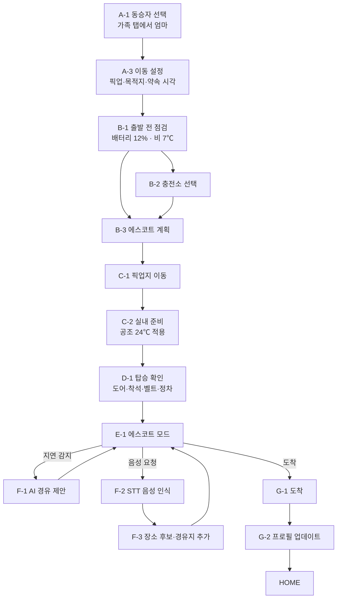

# 모심 (募心)

> 동승자마다 다른 취향을 기억하고, 출발 전 차량 점검부터 탑승 전 실내 준비, 이동 중 케어와 도착 후 기록까지 운전자를 돕는 동승자 에스코트 서비스, ‘모심’

현대자동차그룹 차량용 앱 개발 공모전 제출작이다. Pleos Connect(Android Automotive OS) 환경에서 동작한다.

서비스명 **모심**에는 두 가지 뜻을 담았다. 동승자를 정성껏 **모신다**는 뜻과, 동승자의 취향과 마음을 기록해 **모은다**는 뜻이다.

---

## 1. 프로젝트 소개

### 개발 배경

가족, 연인부터 직장 상사나 거래처까지, 누군가를 ‘모시는’ 이동은 생각보다 잦다.
이때 운전자는 동승자마다 다른 선호를 매번 기억하고 직접 맞춰야 한다.

- 동승자마다 좋아하는 온도, 좌석, 음악이 달라 탑승 때마다 운전자가 직접 설정한다.
- **동승자가 탄 뒤에는 충전, 경로 변경, 실내 설정을 바꾸기 어렵다.** 출발 전에 놓친 준비는 이동 내내 불편으로 남는다.
- 아이를 재우는 날, 부모님을 병원에 모시는 날, 상사를 태우는 날마다 챙길 것이 다르다.

기존 차량 개인화는 **운전자 중심**이다. 실제로 Pleos Connect 에뮬레이터에서 확인해 보니
좌석 메모리 기능은 운전석(`ROW_1_LEFT`)만 지원하고, 조수석 설정을 저장하거나 불러오는 방법이 없었다.

### 해결하려는 문제

모심은 **“동승자가 탄 뒤에는 바꾸기 어렵다”** 는 점에 주목한다.
그래서 출발 전 판단과 탑승 전 준비에 무게를 두고, 운전자의 준비 부담을 줄인다.

### 핵심 사용자

다양한 동승자를 번갈아 태우며 누군가를 모시는 이동이 잦은 운전자.

### 핵심 설계 원칙

> **동승자 탑승 후 운전자의 화면 조작 최소화**

이 원칙에 맞춰 전체 화면과 이용 흐름을 설계했다.
동승자가 타기 전에는 정보를 모아 판단을 돕고, 탄 뒤에는 큰 글씨와 음성 위주로만 동작한다.

---

## 2. 주요 기능

실제 코드에 구현된 기능만 적는다. **실제 SDK 연동**과 **Mock 기반 시연**을 구분해 표시했다.
자세한 검증 범위는 [8. 검증 상태 및 제한사항](#8-검증-상태-및-제한사항)에 있다.

| # | 기능 | 화면 | 데이터 출처 |
|---|---|---|---|
| 1 | 동승자 프로필 및 이동 설정 | A-1, A-2, A-3 | Mock 프로필 + 카카오 로컬(장소 검색) |
| 2 | 출발 전 차량 상태 점검 | B-1 | Mock 차량 상태 + NaviHelper(거리·ETA) |
| 3 | 충전소 경유 선택 | B-2 | Mock 충전소 후보 |
| 4 | 에스코트 계획(단계별 시각표) | B-3 | 앱 내 계산 |
| 5 | 픽업지 이동 · 실내 환경 준비 | C-1, C-2 | Vehicle SDK(공조 온도) + Mock(좌석·음악) |
| 6 | 탑승 확인 및 에스코트 전환 | D-1 | Mock 탑승 신호 |
| 7 | 이동 중 에스코트 모드 | E-1 | NaviHelper(경로·ETA·도착) |
| 8 | STT 기반 음성 요청 | F-2 | Pleos SpeechToText 3.3.1 |
| 9 | AI 경유 제안 및 TTS 안내 | F-1 | 앱 내 규칙 판단 + Pleos TextToSpeech 3.3.1 |
| 10 | 주변 장소 검색 및 경유지 추가 | F-3 | 카카오 로컬 API + NaviHelper `addWaypoint` |
| 11 | 도착 및 프로필 업데이트 | G-1, G-2 | NaviHelper 도착 이벤트 + 앱 내 상태 |

### 기능별 설명

**① 동승자 프로필과 이동 설정**
호칭, 관계, 앉는 자리와 함께 선호 공조 온도, 등받이 각도, 음악 볼륨을 프로필로 저장한다.
가족·상사·지인 등 관계별 탭에서 모실 사람을 고르고, 픽업 장소·목적지·약속 시각을 함께 정해 이후 점검의 기준으로 쓴다.
프로필 데이터는 현재 **Mock**이며 프로세스 범위로만 유지된다(영속 저장은 미구현).

**② 출발 전 판단**
차량 상태(배터리, 실내 온도), 이동 상태(픽업지·목적지까지 거리와 도착 시각), 날씨를 한 화면에 모아
“픽업 전 충전이 필요합니다”처럼 해야 할 일을 먼저 알려 준다.
거리와 ETA는 NaviHelper에서 가져오고, 배터리와 날씨는 Mock이다.

**③ 충전소 경유와 계획 확정**
배터리가 부족하면 경로 위 충전소를 추천하고, 경유를 고르면 충전·공조·픽업·출발·도착까지 단계별 시각표에 반영한다.

**④ 픽업 전 실내 준비**
저장해 둔 공조·좌석·음악 설정을 한 번에 적용하고 항목마다 진행 상태를 보여 준다.
**공조 목표 온도만 실제 Vehicle SDK(`setHvacTemperature`)로 적용**하고, 좌석과 음악은 Mock이다.
설정 온도는 그때의 바깥 기온과 쌍으로 저장해 두고, 날씨가 달라지면 체감에 맞게 보정한다
(`CabinTempRecommender`, 아래 추천 공식 참고).

**⑤ 탑승 확인과 에스코트 전환**
조수석 문 열림→닫힘, 조수석 착석, 안전벨트, 정차 네 신호가 모두 들어오면 확인 버튼이 켜지고,
운전자가 한 번 누르면 에스코트 모드로 바뀐다. 차량 신호만으로는 누가 탔는지 확정할 수 없기 때문이다.
현재 네 신호는 **Mock**(`MockBoardingSignalSource`)으로 재현한다.

**⑥ 이동 중 에스코트 모드**
동승자 이름, 목적지, 도착 예정 시각과 실내 온도·음악·좌석만 큰 글씨로 보여 주는 단순한 화면이다.
제안과 알림은 헤드업 알림으로 띄운다.

**⑦ 음성 요청 (STT)**
동승자가 말한 문장을 Pleos SpeechToText(ON_DEVICE, ko-KR)로 받는다.
의도 해석은 **LLM이 아니라 키워드 규칙**(`VoiceCommandParser`)으로 한다. 왜 그렇게 판단했는지 설명할 수 있고 동작이 일정하기 때문이다.
장소 요청(카페·휴게소 등), 온도 요청, 등받이, 볼륨 요청으로 구분하며,
해석하지 못한 문장은 성공으로 처리하지 않고 “요청을 이해하지 못했어요”만 안내한다.

**⑧ AI 경유 제안과 TTS 안내**
길이 막혀 도착이 늦어질 것으로 보이면 쉬어 갈 곳을 먼저 제안한다(`RestPlaceRule`).
제안 안내는 Pleos TextToSpeech(ON_DEVICE, ko-KR)로 읽어 주며, 제안 하나당 한 번만 말한다.

**⑨ 주변 장소 검색과 경유지 추가**
카카오 로컬 API로 현재 위치 주변을 검색하고, 고른 곳을 NaviHelper `addWaypoint`로 실제 경로에 넣는다.
좌표가 없는 결과는 경유지로 보내지 않는다. 추가에 성공해야만 에스코트 화면으로 돌아간다.

**⑩ 도착과 프로필 업데이트**
NaviHelper 도착 이벤트로 이동을 마치고, 이번에 바뀐 설정을 보여 준 뒤 운전자가 고른 항목만 프로필에 반영한다.

### 차량 특화 요소

- 착석·안전벨트·도어·정차 신호로 탑승을 판단한다. 스마트폰 앱으로는 할 수 없다.
- 동승자가 타기 전에 **실제 차량 공조를 미리 맞춰 둔다.**
- 차량 상태와 내비게이션 경로, 도착 시점 예상 배터리를 함께 보고 출발 전에 판단한다.
- 탑승 후에는 큰 글씨와 음성 위주로만 동작해 주행 중 조작을 줄인다.
- 운전자 중심의 차량 개인화를 동승자까지 넓힌다.

### 추천 온도 공식

```
추천온도 = 과거 설정온도 − k × (현재 바깥 기온 − 과거 바깥 기온)
```

`k = 0.1`, 0.5℃ 단위로 반올림하고 18~28℃ 안으로 제한한다.
예를 들어 바깥 5℃일 때 24℃를 고른 동승자라면, 바깥 25℃인 날에는 22℃를 추천한다.
k값은 아직 확정되지 않았고 기록이 쌓이면 보정할 계획이다.

---

## 3. 주요 사용자 흐름

대표 시나리오: **비 오는 아침, 엄마를 병원에 모셔다 드리는 날**
(강남역에서 08:30에 모시고 서울대병원 본관까지. 숫자는 시연용 예시다.)



1. **동승자 선택** — 가족 탭에서 엄마를 고른다. 저장된 설정(24℃ · 조수석 등받이 110° · 조용한 음악)을 확인하고 픽업 장소·목적지·약속 시각을 정한다.
2. **출발 전 점검** — 배터리 12%, 목적지 도착 예상 잔량 4%라 “픽업 전 충전이 필요합니다”를 띄운다. 비가 와서 지붕이 있는 4번 출구와 사전 공조도 함께 제안한다.
3. **충전소 경유와 계획 확정** — 충전소를 고르면 충전·공조·픽업·도착까지 시간표가 만들어진다. 운전자는 ‘안내 시작’만 누른다.
4. **픽업지 이동** — 큰 글씨로 도착 예정 시각과 남은 거리만 보여 준다.
5. **실내 준비** — 저장한 날(바깥 5℃)과 오늘(바깥 7℃·비)을 비교해 24℃를 적용한다.
6. **탑승 확인** — 네 신호가 확인되면 “엄마가 탑승하셨나요?”에 운전자가 한 번 누른다.
7. **에스코트 모드** — 엄마·목적지·도착 예정 시각만 보여 준다. “좀 추워”는 온도 조절로, “커피 마시고 싶어”는 근처 카페 후보로 이어진다.
8. **도착과 프로필 업데이트** — 이번에 바뀐 설정을 보여 주고, 운전자가 고른 것만 저장한다.

---

## 4. 기술 스택

버전은 `gradle/libs.versions.toml`과 `app/build.gradle.kts` 기준이다.

| 항목 | 버전 |
|---|---|
| Kotlin | 2.2.20 |
| Jetpack Compose | BOM 2025.08.00 (Material3) |
| Navigation Compose | 2.9.0 |
| Lifecycle | 2.9.1 |
| AGP | 8.13.0 |
| Gradle | 8.13 |
| compileSdk / targetSdk / minSdk | 36 / 35 / 28 |
| Pleos Vehicle SDK | 2.3.2 |
| Pleos NaviHelper | 3.0.5 |
| Pleos SpeechToText | 3.3.1 |
| Pleos TextToSpeech | 3.3.1 |
| 카카오맵 Android SDK | 2.15.2 |
| 카카오 로컬 REST API | — |

버전 조합 근거는 아래 “확정 버전”과 `docs/versions-baseline.md`에 있다.

---

## 5. 프로젝트 구조

단일 `app` 모듈이다. 1주일 일정에서 모듈 분리 비용이 더 크다고 판단했다.

```
app/src/main/java/com/example/mosim
├─ MainActivity.kt        앱 진입점. Compose setContent만 담당
├─ MosimApplication.kt    카카오맵 네이티브 로드 실패 처리
├─ navigation/            경로 상수(MosimRoute)와 NavHost. 화면 전환은 전부 여기서 정한다
├─ ui/                    공통 Compose 요소, Pleos 디자인 토큰과 테마
├─ feature/<화면>/         화면 하나당 패키지 하나 (passenger, vehicle, charging,
│                         escort, pickup, boarding, voice, waypoint, planrevision,
│                         arrival, profile, route, home)
├─ data/                  EscortSession(화면 간 공유 상태), mock/(Mock 구현),
│                         passenger/, place/, remote/kakao/
└─ platform/pleos/        Pleos SDK 경계. 화면이 보는 인터페이스와 모델
docs/                     요구사항·구조·SDK 현황·통합 계약 문서
```

**설계 원칙**

- 화면 코드는 Pleos SDK 타입을 직접 쓰지 않는다. `platform/pleos`의 인터페이스만 본다.
  덕분에 SDK 연동이 끝나기 전에도 Mock으로 같은 흐름을 개발하고 시연할 수 있었다.
- 화면 Composable에 NavController를 넘기지 않는다. `onBack`, `onNavigate` 콜백만 받는다.
- Mock도 실제 SDK처럼 **비동기**로 값을 주고, `null`과 실패 경우까지 재현한다.

경계별 실제 구현과 Mock 대응은 `docs/integration-contracts.md` 5절에 표로 정리돼 있다.

---

## 6. 실행 방법

### APK 설치 (권장)

[8. 검증 상태](#8-검증-상태-및-제한사항)를 먼저 읽고 설치한다.

```bash
# Pleos Connect 에뮬레이터를 먼저 실행한 뒤
adb install -r --user 10 모심_모심_release.apk
adb shell am start --user 10 -n com.example.mosim/.MainActivity
```

> Pleos Connect는 Android Automotive 멀티유저 환경이라 앱이 **user 10**에 설치된다.
> `--user 10`을 빼면 설치는 되지만 런처에 보이지 않을 수 있다.

| 항목 | 값 |
|---|---|
| APK 파일명 | `모심_모심_release.apk` |
| applicationId | `com.example.mosim` |
| 메인 Activity | `com.example.mosim.MainActivity` |
| 빌드 타입 | release (서명됨, APK Signature Scheme v2) |

설치 후 런처에서 **모심** 아이콘을 눌러도 실행된다.

### 소스에서 빌드

```bash
git clone https://github.com/codesooo/Mosim.git
cd Mosim
```

`local.properties`는 Git에 없다. Android Studio로 프로젝트를 한 번 열면 SDK 경로를 넣어 자동 생성한다.
CLI만 쓴다면 직접 만든다.

```properties
# local.properties
sdk.dir=C:/Users/<사용자>/AppData/Local/Android/Sdk

# 선택. 없으면 장소 검색은 Mock, 지도는 자리 표시로 떨어진다(앱은 죽지 않는다)
KAKAO_REST_API_KEY=<카카오 REST API 키>
KAKAO_NATIVE_APP_KEY=<카카오 네이티브 앱 키>
```

```bash
./gradlew :app:assembleDebug        # 디버그 APK
./gradlew :app:testDebugUnitTest    # 단위 테스트
./gradlew :app:assembleRelease      # 릴리스 APK (서명 설정이 있을 때만 서명됨)
```

Windows PowerShell에서는 `.\gradlew.bat`을 쓴다.

> `assembleRelease` 서명은 저장소에 없는 `keystore.properties`(루트)에서 읽는다.
> 이 파일이 없으면 release는 **서명 없이** 빌드된다. 제출용 서명 APK는 아래 Release 링크에서 받는다.

### 주요 화면 시연 방법

HOME 화면의 개발용 메뉴로 각 화면에 단독 진입할 수 있고, ‘동승자 선택’부터 누르면 A→G 전체 흐름이 이어진다.

차량 상태는 에뮬레이터 안 **Virtual Console(8088 포트)** 로 바꿔 가며 시연한다.

디버그 빌드에는 시연용 진입점이 더 있다(**release APK에는 포함되지 않는다**).

```bash
# 정체 상황 → F-1 AI 제안
adb shell am broadcast --user 10 -a com.example.mosim.DEBUG_DELAY --ei minutes 30 \
  -n com.example.mosim/.debug.DebugTripReceiver
# 목적지 도착 → G-1
adb shell am broadcast --user 10 -a com.example.mosim.DEBUG_ARRIVE \
  -n com.example.mosim/.debug.DebugTripReceiver
# 음성 문장 주입 (마이크 없이 음성 경로 시연)
adb shell am broadcast --user 10 -a com.example.mosim.DEBUG_SAY --es text "커피 마시고 싶어" \
  -n com.example.mosim/.debug.DebugSpeechReceiver
```

---

## 7. 테스트 환경

### 개발·검증 환경

| 항목 | 값 |
|---|---|
| Pleos Connect 에뮬레이터 | **v2.1.0** (`android-automotive`, API 34) |
| 화면 규격 | **2560 × 1440**, density 160 (mdpi) |
| AVD 설정 | Automotive 기기, API 34, Cold boot, RAM 4GB 권장 |
| Android API Level | 34 (minSdk 28 / targetSdk 35 / compileSdk 36) |
| JDK | 17 (프로젝트 기준). 제출 APK는 JDK 21로 빌드했다 |
| Gradle / AGP | 8.13 / 8.13.0 |
| Android Studio | 안정판(Narwhal 4 또는 Otter). 캐너리는 쓰지 않는다 |

> SDK 검증 기록(`docs/context/sdk-status.md`)은 **arm64** Pleos 에뮬레이터에서,
> 이번 release APK 설치·실행 확인은 **x86_64** Pleos 에뮬레이터에서 했다. 8절 참고.

### 에뮬레이터 설치

`Tools > SDK Manager > SDK Update Sites`에 추가한다.

- Name: `Pleos Connect System Image`
- Windows/Linux: `https://nexus-playground.pleos.ai/repository/raw-releases/connect-avd/2.x/crp-sys-img.xml`
- Mac: `https://nexus-playground.pleos.ai/repository/raw-releases/connect-avd/2.x/crp-arm64-sys-img.xml`

Android SDK에서 **API 36**(compileSdk), **API 34**(Pleos 에뮬레이터), **Build-Tools 36.0.0**, **Platform-Tools**를 설치한다.

### 필요한 권한

매니페스트에는 실제로 쓰는 API의 최소 권한만 선언했다.

| 권한 | 쓰는 곳 |
|---|---|
| `INTERNET` | 카카오 로컬 장소 검색, 지도 타일 |
| `pleos.car.permission.CAR_CLIMATE` / `CONTROL_CAR_CLIMATE` | 공조 온도 조회·설정 |
| `pleos.car.permission.CAR_SEATS` / `CONTROL_CAR_SEATS` | 동승석 등받이 |
| `pleos.car.permission.NAVI_ROUTE` / `NAVI_ROUTE_SEARCH` | 경로·ETA 조회, 경유지 추가 |
| `pleos.car.permission.STT_SERVICE` / `TTS_SERVICE` | 음성 인식·안내 |
| `android.permission.RECORD_AUDIO` | STT `request()` 경로에 음성이 들어오게 하는 데 필요 |
| `android.permission.POST_NOTIFICATIONS` | E-2·F-1 헤드업 알림 |

`RECORD_AUDIO`와 `POST_NOTIFICATIONS`는 **런타임 승인**이 필요하다. F-2 진입과 에스코트 진입 때 요청한다.

### 네트워크·외부 서비스

| 항목 | 없을 때 동작 |
|---|---|
| 인터넷 | 장소 검색과 지도가 동작하지 않는다. 앱은 죽지 않는다 |
| `KAKAO_REST_API_KEY` | 장소 검색이 **Mock**으로 떨어진다 |
| `KAKAO_NATIVE_APP_KEY` | 지도가 자리 표시(`MapPlaceholder`)로 떨어진다 |

**지도 렌더링**: 카카오 벡터맵 AAR에는 `arm64-v8a`, `armeabi-v7a` 네이티브 라이브러리만 들어 있다.
**x86_64 에뮬레이터에서는 `libK3fAndroid.so`를 찾지 못한다.**
`MosimApplication`이 이 실패를 잡고 `MosimMap`이 WebView 지도(Leaflet + OpenStreetMap)로 대신 그린다.
WebView 지도는 실행 시점에 타일을 내려받으므로 네트워크가 없으면 빈 회색 판이 된다.

---

## 8. 검증 상태 및 제한사항

기획안의 ‘계획’과 실제 검증 결과를 구분해서 적는다. **검증하지 못한 것은 검증하지 못했다고 적었다.**

### 실제 SDK 연동 + 에뮬레이터 검증 완료

| 기능 | SDK | 확인 내용 |
|---|---|---|
| 공조 목표 온도 조회·설정 | Vehicle 2.3.2 HVAC | `setHvacTemperature(ROW_1_LEFT, 25.5)` → Virtual Console 반영, 재조회 일치 (2026-11-12, arm64) |
| 경로 요청·남은 거리·현재 위치·경유지 추가 | NaviHelper 3.0.5 | `requestRoute`, `getDestinationInfo`, `addWaypoint` 동작 확인 (2026-11-12 / 11-15, arm64) |
| 음성 안내(TTS) | TextToSpeech 3.3.1 | ON_DEVICE · ko-KR 전체 수명주기와 한국어 합성·재생 확인 (2026-11-13) |
| 주변 장소 검색 | 카카오 로컬 API | 실제 검색 결과 확인 (2026-11-15) |

### 부분 검증

| 기능 | 된 것 | 안 된 것 |
|---|---|---|
| 음성 인식(STT) | 의존성·권한·ON_DEVICE 초기화·ko-KR 적용·마이크 점유·해제. `sendAudio()`로 넣은 PCM은 **한국어 인식 성공** | **사람이 차량 마이크에 말해서 인식되는 경로는 미검증.** 에뮬레이터 마이크에 무음만 들어왔다. 운영 화면은 `request()`를 쓰므로 이 구간은 여전히 미검증 |
| 좌석 등받이 제어 | `moveSeatBackrestAngle` 호출 성공 응답 | **실제 위치 변화 확인 불가.** Virtual Console과 Emulation Controls에 좌석 위치 항목이 없다. 위치값이 계속 0 |
| 도착 감지 | 인터페이스와 Mock으로 흐름 구현 | 에뮬레이터에서 차가 움직이지 않아 실제 `onDestinationArrived` 미검증 |

### Mock 기반 시연

아래는 인터페이스와 Mock까지만 만들었고 실제 SDK 호출 코드를 쓰지 않았다.
`docs/context/sdk-status.md`에서 상태가 ✅가 아니거나 에뮬레이터 검증이 끝나지 않은 SDK다.

- 탑승·하차 감지(착석, 안전벨트, 도어) — `MockBoardingSignalSource`
- 배터리 잔량(EV SOC), 주행 가능 거리, 실내 온도 표시값
- 좌석 위치·음악 적용 상태
- 날씨, 주차 정보 (외부 API 미선정)
- 동승자 프로필 저장소 (프로세스 범위, 영속화 없음)

### release APK 설치·실행 검증 (2026-11-15)

Pleos Connect v2.1.0 **x86_64** 에뮬레이터(API 34, 2560×1440)에서 확인했다.

- 설치 성공, 실행 성공, **크래시 없음**
- A-1 동승자 선택 → A-3 이동 설정 → B-1 출발 전 점검 → B-3 에스코트 계획 →
  C(픽업·실내 준비 자동 진행) → D-1 탑승 확인 → **E-1 에스코트 모드 진입까지 화면 전환 확인**
- 이 x86_64 에뮬레이터 인스턴스에서는 아래가 **동작하지 않았다.**
  - **내비게이션 경로 설정 실패** — 에뮬레이터 내비 게이트웨이(`connect-gw-coral.umos.ai`) DNS 해석 실패
  - **차량 서비스 연결 실패** — 차량 HAL secure storage RPC 거부
  - 두 경우 모두 앱은 죽지 않고 “—” 표시와 안내 문구로 떨어졌다(의도한 동작)
  - 따라서 **E 이후 F·G 화면은 이번 release APK 실행에서 확인하지 못했다.** 위 SDK 검증은 arm64 환경 기준이다
- 카카오 네이티브 지도는 ABI 불일치로 로드되지 않고 WebView 지도로 대체됐다(문서와 일치)

### 알려진 제한사항

- **영속 저장이 없다.** 동승자 프로필과 이동 기록은 프로세스 범위이며 앱을 끄면 사라진다.
- **LLM을 쓰지 않는다.** 음성 의도 해석은 키워드 규칙이다. Pleos LLM SDK는 2026-10-19 종료됐고, 대체 LLM은 팀 미정이다.
- `requestTrip` 호출 직후 안내 중이던 경로가 취소되는 현상을 확인해 **안내 중에는 쓰지 않는다**(원인 미확인).
- 패키지명 `com.example.mosim`은 임시다.
- 추천 온도 공식의 `k`값(0.1)은 확정되지 않았다.
- `docs/requirements.md`는 아직 비어 있다.
- arm 기기에서 카카오 **네이티브** 지도가 실제로 그려지는지는 아직 확인하지 못했다.

---

## 9. APK 다운로드

| 경로 | 링크 |
|---|---|
| GitHub Release | [v1.0.0](https://github.com/codesooo/Mosim/releases/tag/v1.0.0) |
| 저장소 내 경로 | [`apk/모심_모심_release.apk`](apk/모심_모심_release.apk) |

- 파일명: `모심_모심_release.apk`
- 빌드: release, 서명됨(APK Signature Scheme v2)
- 설치 방법은 [6. 실행 방법](#6-실행-방법) 참고

---

## 10. 확정 버전

버전을 임의로 바꾸지 않는다. 변경 전 상태는 `docs/versions-baseline.md`에 있다.

| 항목 | 버전 | 근거 |
|---|---|---|
| JDK | **17** | AGP 8.13 최소·기본 JDK. Pleos 공식 샘플도 JDK 17 |
| Gradle | **8.13** | AGP 8.13이 요구하는 최소 Gradle |
| AGP | **8.13.0** | 안정판 Android Studio가 지원하는 최신 AGP |
| Kotlin | **2.2.20** | AGP 8.13.0 지원 범위. Kotlin 2.3은 AGP 8.13.2부터 |
| Compose Compiler | Kotlin과 동일 | Kotlin 2.0부터 컴파일러 플러그인 버전이 Kotlin 버전과 같다 |
| Compose BOM | **2025.08.00** | Compose 라이브러리 버전은 BOM이 정한다 |
| compileSdk | **36** | AGP 8.13이 지원하는 최대 API. 최신 androidx가 36을 요구 |
| targetSdk | **35** | Pleos Vehicle SDK 공식 샘플과 동일 |
| minSdk | **28** | Pleos Playground 배포 요건(서명키 rotation·lineage) |

---

## 11. 문서

| 문서 | 내용 |
|---|---|
| `AGENTS.md` / `CLAUDE.md` | 공통 개발 규칙, 커밋 규칙, 디렉터리 규칙 |
| `docs/architecture.md` | 구조와 미결정 항목 |
| `docs/integration-contracts.md` | 화면 전환 조건, 공유 상태, 외부 경계 요약 |
| `docs/context/project-status.md` | 지금 무엇이 있고 무엇이 정해졌는지 |
| `docs/context/sdk-status.md` | SDK별 상태와 **에뮬레이터 검증 기록** |
| `docs/context/contest.md` | 공모전 규칙과 제약 |
| `docs/reference/pleos/` | Pleos 개발자 문서 정리본(시그니처 확인용) |
| `docs/voice-stt.md`, `docs/f-screens.md` | STT 구현과 F 화면 세부 |
| `docs/versions-baseline.md` | 버전 변경 전 상태와 변경 이유 |

---

## 12. 개발 규칙

- `main`에 직접 push하지 않는다. `feature/<이름>` 브랜치 + Pull Request.
- `local.properties`, `.idea/`, 서명키(`*.jks`, `*.keystore`), `keystore.properties`, 빌드 산출물은 커밋하지 않는다.
- 코드·커밋·README·스크린샷에 개발자 실명, 연락처, 계정 정보, API 키를 넣지 않는다. 키는 `local.properties`에서 읽는다.
- Pleos SDK API를 추측해서 구현하지 않는다. 확인하지 못한 사실에는 `[확인 필요]`를 붙인다.

푸시 전 확인:

```bash
./gradlew :app:assembleDebug :app:testDebugUnitTest
```

---

저장소: https://github.com/codesooo/Mosim
